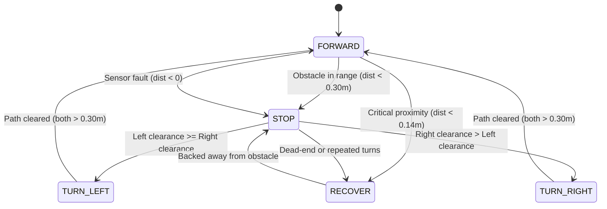

# Four-Wheel Rough-Terrain Inspection Rover (Webots R2025a)

A complete, demonstrable four-wheel Rough-Terrain Inspection Rover simulation project developed for **Webots R2025a**. Built with realistic robot kinematics, 4-wheel differential-drive physics, calibrated distance sensors, and an autonomous finite-state machine (FSM) navigation controller.

---

## 1. Project Overview

The **Rough-Terrain Inspection Rover** is an autonomous four-wheel robotic platform engineered to navigate cluttered environments, detect obstacles, evaluate lateral clearances, negotiate rocky terrain slabs, and climb inspection ramps.

### Key Highlights
- **Realistic Mobile Robot Geometry:** Engineered with a rigid graphite/dark metallic-blue chassis, front/rear protective bumpers, an upper inspection equipment deck, a sensor mast with an inspection status beacon, and front/rear marker lights.
- **Independent 4-Wheel Differential Drive:** Each of the 4 wheels is mounted via a high-fidelity `HingeJoint` driven by dedicated `RotationalMotor` velocity controllers with matched sign conventions.
- **Calibrated Infrared Distance Sensors:** Dual forward-facing sensors (`front_left_distance` and `front_right_distance`) situated on the front bumper without chassis occlusion. Raw lookup signals are mathematically converted to meters via piecewise-linear interpolation.
- **Robust Finite-State Machine (FSM):** Complete autonomous logic supporting `FORWARD`, `STOP`, `TURN_LEFT`, `TURN_RIGHT`, `RECOVER`, and `REVERSE` states with anti-oscillation safeguards and dead-end recovery.
- **100% Self-Contained:** Uses Webots R2025a built-in primitive geometries and procedural materials with zero external asset dependencies or pip requirements.

---

## 2. Project Directory Structure

```text
RoverProject/
├── worlds/
│   └── rough_terrain_rover.wbt          # Complete simulation world (arena, obstacles, rocks, ramp)
├── controllers/
│   └── rough_terrain_controller/
│       └── rough_terrain_controller.py  # Python autonomous FSM controller
├── protos/
│   └── RoughTerrainRover.proto          # Parameterized 4WD rover robot definition
├── docs/
│   └── simulation_test_plan.md          # Formal verification test procedures and criteria
└── README.md                            # Comprehensive project guide & documentation
```

---

## 3. Webots Version & Environment Requirements

- **Simulator:** Webots R2025a (or newer).
- **Controller Language:** Python 3.9+ using Webots' native built-in `controller` API.
- **Dependencies:** **Standard Python library only** (`math`, `sys`). No external `pip` packages required.
- **Platform Compatibility:** Windows 10/11, macOS, and Linux.

---

## 4. Robot Specifications & Kinematics

| Parameter | Specification | Details |
|---|---|---|
| **Chassis Dimensions** | $0.50\,\text{m} \times 0.36\,\text{m} \times 0.12\,\text{m}$ | Length ($X$) $\times$ Width ($Z$) $\times$ Height ($Y$) |
| **Chassis Mass** | $12.0\,\text{kg}$ | Center of mass lowered ($Y = 0.01\,\text{m}$) for slope stability |
| **Wheel Count** | $4$ independent wheels | Front-Left, Front-Right, Rear-Left, Rear-Right |
| **Wheel Radius ($R$)** | $0.075\,\text{m}$ ($75\,\text{mm}$) | Diameter = $0.15\,\text{m}$ |
| **Wheel Width ($W$)** | $0.045\,\text{m}$ ($45\,\text{mm}$) | High-traction rubber contact profile |
| **Wheel Mass** | $1.0\,\text{kg}$ each | Total vehicle weight = $16.0\,\text{kg}$ |
| **Wheelbase** | $0.32\,\text{m}$ | Front axle ($X = +0.16\,\text{m}$), Rear axle ($X = -0.16\,\text{m}$) |
| **Track Width** | $0.44\,\text{m}$ | Left wheels ($Z = +0.22\,\text{m}$), Right wheels ($Z = -0.22\,\text{m}$) |
| **Ground Clearance** | $0.05\,\text{m}$ ($50\,\text{mm}$) | Ample clearance for low obstacles |
| **Coordinate System** | **NUE** | $+X$ = Forward, $+Y$ = Up (Vertical), $+Z$ = Lateral (Left) |
| **HingeJoint Axis** | `[0, 0, -1]` | Standardized for all 4 motors (positive velocity = forward) |

---

## 5. Actuators & Sensors

### Motors (RotationalMotor)
The 4 motors use velocity control with position set to infinity:
- `left_front_motor`
- `left_rear_motor`
- `right_front_motor`
- `right_rear_motor`

**Motor Limits:**
- Maximum Angular Velocity: $10.0\,\text{rad/s}$
- Cruise Velocity: $+4.0\,\text{rad/s}$ (linear speed $\approx 0.30\,\text{m/s}$)
- Turn Velocity: $\pm 2.5\,\text{rad/s}$
- Reverse Velocity: $-2.0\,\text{rad/s}$
- Maximum Available Torque: $30.0\,\text{N}\cdot\text{m}$

### Distance Sensors (DistanceSensor)
- `front_left_distance`: Mounted at $(X = 0.255\,\text{m}, Y = 0.035\,\text{m}, Z = +0.10\,\text{m})$, facing $+X$.
- `front_right_distance`: Mounted at $(X = 0.255\,\text{m}, Y = 0.035\,\text{m}, Z = -0.10\,\text{m})$, facing $+X$.

#### Lookup Table Calibration
Webots distance sensors output a raw analog signal rather than meters. In `RoughTerrainRover.proto`, the sensor lookup table is defined as:

$$\begin{aligned}
\text{Distance } 0.00\,\text{m} &\longrightarrow \text{Signal } 1000.0 \\
\text{Distance } 0.30\,\text{m} &\longrightarrow \text{Signal } 850.0 \\
\text{Distance } 1.00\,\text{m} &\longrightarrow \text{Signal } 500.0 \\
\text{Distance } 2.00\,\text{m} &\longrightarrow \text{Signal } 0.0
\end{aligned}$$

The Python controller function `raw_signal_to_distance(raw_signal)` performs exact piecewise-linear inverse interpolation:

```python
def raw_signal_to_distance(raw_signal: float) -> float:
    # Interpolates across segments: [0.0 - 0.3m], [0.3 - 1.0m], [1.0 - 2.0m]
    # Maps raw signal accurately back to metric distances.
    # Returns -1.0 if sensor reading is corrupt or invalid (fail-safe).
```

---

## 6. Controller State Machine Architecture

The controller implements a deterministic Finite-State Machine:



- **`FORWARD`**: Drives both left and right wheels forward at $+4.0\,\text{rad/s}$.
- **`STOP`**: Sets all motor velocities to $0.0\,\text{rad/s}$. Evaluates left vs. right clearances after a stabilization pause.
- **`TURN_LEFT`**: Differential turn (`left_speed = -2.5`, `right_speed = +2.5`). Minimum duration of 30 steps prevents rapid twitching.
- **`TURN_RIGHT`**: Differential turn (`left_speed = +2.5`, `right_speed = -2.5`).
- **`RECOVER` / `REVERSE`**: Reverses the rover at $-2.0\,\text{rad/s}$ for 25 steps to back away from dead-ends or tight corners before re-evaluating.

---

## 7. How to Open and Run the Simulation

### Option A: Windows
1. Copy or extract the project folder to `C:\RoverProject` (a short path prevents Windows path length issues).
2. Launch **Webots R2025a**.
3. In the top menu, select **File -> Open World...** (`Ctrl + O`).
4. Browse to:
   ```text
   C:\RoverProject\worlds\rough_terrain_rover.wbt
   ```
5. Click the **Run / Play** button in the Webots toolbar (or press `Ctrl + 2`).
6. Observe the rover approaching the primary obstacle, stopping, evaluating clearances, turning toward the open side, and continuing navigation.
7. To reset the simulation at any point, click the **Reset** button in the Webots toolbar (or press `Ctrl + Shift + T`).

### Option B: macOS / Linux
1. Open terminal and navigate to the project directory:
   ```bash
   cd /Users/shubhampatel/rover
   ```
2. Launch Webots and open `worlds/rough_terrain_rover.wbt`:
   ```bash
   open -a Webots worlds/rough_terrain_rover.wbt
   # Or directly from the Webots GUI: File -> Open World
   ```
3. Press **Run** (`Cmd + 2`) in the Webots window.

---

## 8. Simulation Test Environment

The test world `rough_terrain_rover.wbt` provides a comprehensive rough-terrain proving ground:
1. **Arena Floor:** An expansive $16\,\text{m} \times 16\,\text{m}$ high-friction testing surface bounded by perimeter safety walls.
2. **Primary Obstacle:** Placed directly along the rover's initial heading at $X = 1.5\,\text{m}$ ($0.4\,\text{m} \times 0.3\,\text{m} \times 0.3\,\text{m}$ hazard crate). Validates forward cruising, distance threshold detection ($0.30\,\text{m}$), and stopping.
3. **Secondary Obstacle:** Placed offset to the right at $X = 2.2\,\text{m}, Z = -0.8\,\text{m}$. Constrains the right side to demonstrate intelligent direction selection (turning left toward open ground).
4. **Rough-Terrain Rock Formations:** Low rock slabs ($7.0 - 9.0\,\text{cm}$ high) placed at angles ($X \approx 2.8 - 3.4\,\text{m}, Z \approx 0.9 - 1.6\,\text{m}$) to demonstrate rough-terrain traction and wheel interaction.
5. **Gentle Ramp & Platform:** An inclined plane ($8.5^\circ$ slope, $1.6\,\text{m}$ long) leading to an elevated inspection platform ($Y = 0.24\,\text{m}$) testing torque and grade climbing.

---

## 9. Troubleshooting

| Symptom | Cause | Solution |
|---|---|---|
| **"Could not find PROTO" error** | Relative path to proto altered | Ensure the folder structure maintains `worlds/` and `protos/` side-by-side, or keep `EXTERNPROTO "../protos/RoughTerrainRover.proto"`. |
| **Controller does not start** | Python not configured in Webots | In Webots, go to **Tools -> Preferences -> Python Command** and ensure a valid Python 3 interpreter (e.g. `python` or `python3`) is selected. |
| **Rover doesn't move** | Simulation is paused | Click the **Play** button in the Webots top toolbar. |
| **Distance readings always 2.0m** | Ray missed obstacle or out of range | Distance sensor range is configured to $2.0\,\text{m}$. Obstacles beyond $2.0\,\text{m}$ read as clear path. |
| **Windows path length warning** | Deeply nested directory | Move the project to `C:\RoverProject` as recommended. |

---

## 10. Known Limitations & Unverified Behavior

1. **Rigid Chassis Suspension:** The rover uses a rigid chassis without a rocker-bogie differential suspension. Traversal over rock obstacles higher than the wheel radius ($> 75\,\text{mm}$) may cause high-centering.
2. **Infrared Sensor Environmental Limits:** In a real-world setting, infrared distance sensors are sensitive to surface reflectivity and ambient lighting; the simulation assumes uniform diffuse reflectivity.
3. **Slip on Steep Inclines:** On inclines exceeding $25^\circ$, the rover may experience slip depending on the friction coefficient configured in `ContactProperties`.
